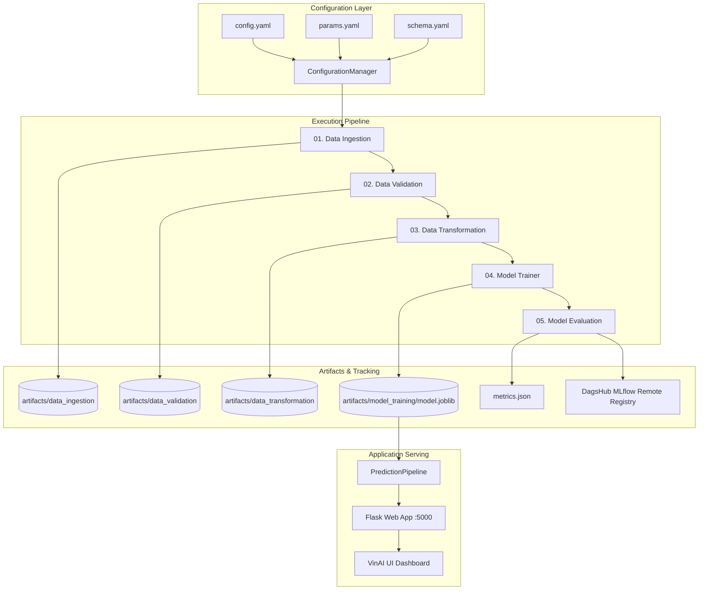

# 🍷 VinAI: Production-Grade End-to-End Data Science & MLOps Platform

[](https://www.python.org/)
[](https://flask.palletsprojects.com/)
[](https://scikit-learn.org/)
[](https://mlflow.org/)
[](https://dagshub.com/)
[](LICENSE)

An enterprise-ready, modular Machine Learning Operations (MLOps) platform built for predictive physicochemical analysis of wine quality. This repository demonstrates end-to-end industry best practices: automated data ingestion, strict schema validation, feature engineering, regularized ElasticNet modeling, remote experiment tracking & model registry via DAGsHub MLflow, and an executive-grade web application interface.

---

## 📑 Table of Contents

- [System Architecture](#-system-architecture)
- [ML Pipeline Workflow](#-ml-pipeline-workflow)
- [Project Directory Structure](#-project-directory-structure)
- [Tech Stack](#-tech-stack)
- [Getting Started](#-getting-started)
  - [Prerequisites](#prerequisites)
  - [Installation](#installation)
  - [Environment Configuration](#environment-configuration)
- [Usage & Execution](#-usage--execution)
  - [1. Running the ML Pipeline (CLI)](#1-running-the-ml-pipeline-cli)
  - [2. Launching the Web Application](#2-launching-the-web-application)
- [API Endpoints](#-api-endpoints)
- [Experiment Tracking & Model Registry](#-experiment-tracking--model-registry)
- [Software Engineering Standards](#-software-engineering-standards)
- [Author & License](#-author--license)

---

## 🏛 System Architecture

The project follows a decoupled, configuration-driven modular design pattern where configuration, entities, components, and pipeline runners are isolated.



---

## 🔄 ML Pipeline Workflow

Each pipeline stage follows the standardized 7-step engineering pattern:
1. Update `config/config.yaml`
2. Update `schema.yaml`
3. Update `params.yaml`
4. Define configuration entities in `src/Datascience/entity/config_entity.py`
5. Implement configuration managers in `src/Datascience/config/configuration.py`
6. Build stage components in `src/Datascience/components/`
7. Assemble and run pipelines in `src/Datascience/pipeline/`

| Stage | Name | Description | Key Output Artifact |
| :--- | :--- | :--- | :--- |
| **01** | **Data Ingestion** | Downloads compressed wine dataset from remote source and extracts raw data. | `artifacts/data_ingestion/winequality-red.csv` |
| **02** | **Data Validation** | Validates ingested data columns and types against `schema.yaml` constraints. | `artifacts/data_validation/status.txt` |
| **03** | **Data Transformation** | Prepares train/test stratified splits (75/25) for model consumption. | `train.csv` (75%), `test.csv` (25%) |
| **04** | **Model Training** | Fits an **ElasticNet** regression model using configured hyperparameters. | `artifacts/model_training/model.joblib` |
| **05** | **Model Evaluation** | Computes RMSE, MAE, R² metrics and logs parameters, metrics & model to MLflow. | `artifacts/model_evaluation/metrics.json` |

---

## 📁 Project Directory Structure

```text
Data-science-Production/
├── .env                                  # Remote MLflow credentials (ignored in Git)
├── .gitignore                            # Standard git exclusions
├── app.py                                # Flask web application & REST API routes
├── Dockerfile                            # Containerization recipe
├── main.py                               # Master CLI execution pipeline
├── params.yaml                           # Model hyperparameters (alpha, l1_ratio)
├── requirements.txt                      # Project dependencies
├── schema.yaml                           # Dataset schema & column definitions
├── template.py                           # Project scaffold generator script
├── config/
│   └── config.yaml                       # Artifact paths and pipeline configurations
├── logs/
│   └── running_logs.log                  # Structured application runtime logs
├── research/                             # Prototyping Jupyter Notebooks
│   ├── 01_data_ingestion.ipynb
│   ├── 02_data_validation.ipynb
│   ├── 03_data_transformation.ipynb
│   ├── 04_model_trainer.ipynb
│   └── 05_model_evaluation.ipynb
├── src/
│   └── Datascience/                      # Core production package
│       ├── __init__.py                   # Global logger setup
│       ├── components/                   # Individual pipeline stage components
│       │   ├── data_ingestion.py
│       │   ├── data_validation.py
│       │   ├── data_transformation.py
│       │   ├── model_trainer.py
│       │   └── model_evaluation.py
│       ├── config/
│       │   └── configuration.py          # Configuration parser & directory builder
│       ├── constants/
│       │   └── __init__.py               # Constant path pointers
│       ├── entity/
│       │   └── config_entity.py          # Strongly typed dataclasses
│       ├── pipeline/                     # Stage runners & inference pipelines
│       │   ├── data_ingestion_pipeline.py
│       │   ├── data_validation_pipeline.py
│       │   ├── data_transformation_pipeline.py
│       │   ├── model_trainer_pipeline.py
│       │   ├── model_evaluation_pipeline.py
│       │   └── prediction_pipelien.py
│       └── utils/
│           └── common.py                 # Utility helpers (YAML, JSON, IO)
└── template/                             # Web interface templates
    ├── index.html                        # Modern VinAI dashboard with interactive presets
    └── results.html                      # Quality evaluation report with animated gauge
```

---

## 🛠 Tech Stack

- **Language**: Python 3.10+
- **Machine Learning**: `scikit-learn`, `numpy`, `pandas`, `joblib`
- **Experiment Tracking & Registry**: `mlflow`, `dagshub`
- **Application Server**: `Flask`, `Jinja2`
- **Configuration & Typing**: `python-box` (`ConfigBox`), `ensure`, `PyYAML`, `dataclasses`
- **Styling**: Modern Vanilla CSS, Glassmorphism, Google Fonts (`Outfit`, `Plus Jakarta Sans`)

---

## 🚀 Getting Started

### Prerequisites

- Python 3.10 or higher installed.
- Conda (recommended) or `venv`.
- Git.

### Installation

1. **Clone the repository:**
   ```bash
   git clone https://github.com/sheshpalsingh01/Data-science-Production.git
   cd Data-science-Production
   ```

2. **Create and activate a virtual environment:**
   ```bash
   conda create -n ml_llmops python=3.10 -y
   conda activate ml_llmops
   ```

3. **Install dependencies:**
   ```bash
   pip install -r requirements.txt
   ```

### Environment Configuration

Create a `.env` file in the root directory to store your DAGsHub MLflow credentials:

```ini
MLFLOW_TRACKING_URI="https://dagshub.com/<username>/<repo_name>.mlflow"
MLFLOW_TRACKING_USERNAME="<your_dagshub_username>"
MLFLOW_TRACKING_PASSWORD="<your_dagshub_token_or_password>"
```

*(Note: `.env` is already configured in `.gitignore` to prevent credential exposure).*

---

## 💻 Usage & Execution

### 1. Running the ML Pipeline (CLI)

To execute the entire 5-stage pipeline from data ingestion to model evaluation and MLflow logging:

```bash
python main.py
```

**Expected Log Output:**
```text
[INFO]: >>>>>>>>>>>>>>>>>>Starting Data Ingestion<<<<<<<<<<<<<<<<<<<
[INFO]: File already exists of size: ~26 KB
[INFO]: data.zip unzipped successfully
[INFO]: >>>>>>>>>>>>>>>>>>Starting Data Validation<<<<<<<<<<<<<<<<<
[INFO]: Validation status written: True
[INFO]: >>>>>>>>>>>>>>>>>>Starting Data Transformation<<<<<<<<<<<<<
[INFO]: Splitted data into training and test sets
[INFO]: >>>>>>>>>>>>>>>>>>Starting Model Trainer Stage<<<<<<<<<<<<<
[INFO]: Model trained and saved to artifacts/model_training/model.joblib
[INFO]: >>>>>>>>>>>>>>>>>>Starting Model Evaluation<<<<<<<<<<<<<<<<
[INFO]: Scores saved: {'rmse': 0.725, 'mae': 0.567, 'r2': 0.286}
[INFO]: Logged metrics & registered ElasticnetModel to DagsHub MLflow!
```

### 2. Launching the Web Application

To start the interactive prediction server:

```bash
python app.py
```

Once running, navigate to:
👉 **`http://localhost:5000/`**

---

## 🌐 API Endpoints

| HTTP Method | Route | Description |
| :--- | :--- | :--- |
| `GET` | `/` | Renders the primary VinAI laboratory input dashboard. |
| `GET` | `/train` | Triggers the complete training pipeline (`main.py`) programmatically. |
| `POST` | `/predict` | Consumes 11 physicochemical wine features and returns predicted quality score. |

### Feature Input Schema (for `/predict`):
- `fixed_acidity`: Tartaric acid content ($g/dm^3$)
- `volatile_acidity`: Acetic acid concentration ($g/dm^3$)
- `citric_acid`: Citric acid volume ($g/dm^3$)
- `residual_sugar`: Post-fermentation sugar ($g/dm^3$)
- `chlorides`: Sodium chloride content ($g/dm^3$)
- `free_sulfur_dioxide`: Free $SO_2$ preservative ($mg/dm^3$)
- `total_sulfur_dioxide`: Total bound and free $SO_2$ ($mg/dm^3$)
- `density`: Water-ethanol mass density ratio ($g/cm^3$)
- `pH`: Acidity balance on 0–14 scale
- `sulphates`: Potassium sulphate additive ($g/dm^3$)
- `alcohol`: Ethanol concentration by percentage volume ($\% vol$)

---

## 📊 Experiment Tracking & Model Registry

This project seamlessly tracks metrics, hyperparameters, and models using **MLflow** connected to a remote **DagsHub** repository:

- **Tracked Parameters**: `alpha`, `l1_ratio`
- **Logged Metrics**: `rmse`, `mae`, `r2`
- **Model Registry**: Models are automatically registered as `ElasticnetModel` within DAGsHub.
- **Local Fallback**: Local metrics are saved to `artifacts/model_evaluation/metrics.json`.

---

## 🛡 Software Engineering Standards

- **Strong Type Enforcement**: All core configuration objects use `@dataclass(frozen=True)` to prevent mutation during pipeline execution.
- **ConfigBox Dictionary Access**: Dot-notation accessibility on deeply nested configuration dictionaries (e.g., `config.model_training.root_dir`).
- **Runtime Type Safety**: Functions utilize `@ensure_annotations` to prevent type mismatches at execution time.
- **Centralized Logging**: Clean timestamped logs recorded both to console and `logs/running_logs.log`.
- **Fault-Tolerant Path Handling**: Robust cross-platform Pathlib abstractions (`Path`) for directory and file manipulation.

---

## 📜 License

This project is licensed under the [MIT License](LICENSE).

## 👤 Author

Developed by **Sheshpal Singh**
- GitHub: [@sheshpalsingh01](https://github.com/sheshpalsingh01)
- DagsHub: [@sheshpalsingh2024](https://dagshub.com/sheshpalsingh2024)
